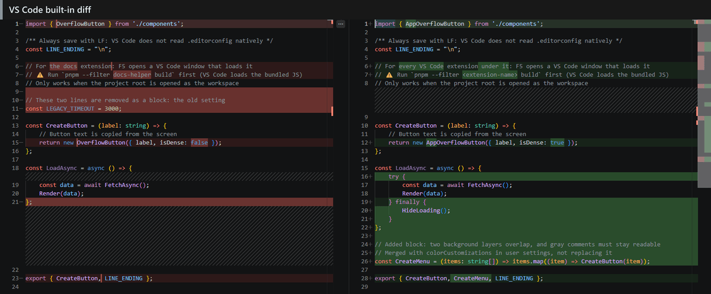
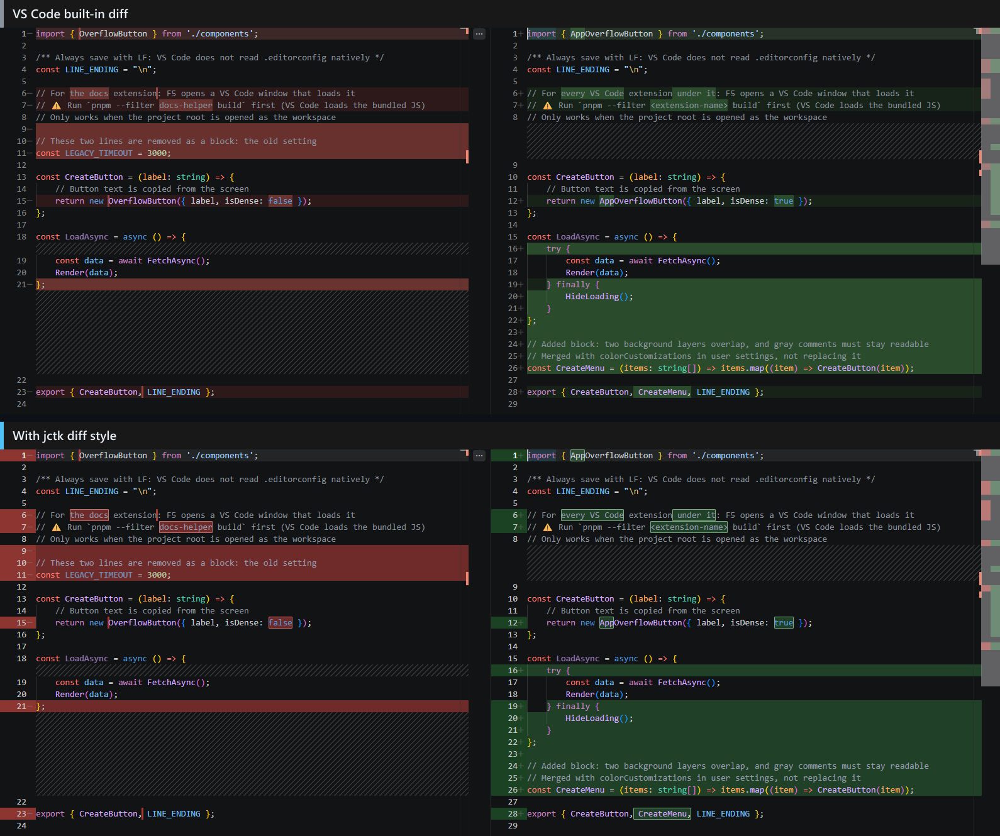

# jctk diff style

See exactly which characters changed in VS Code's diff view, and tune how diffs look in a live settings panel.

## Features

- **Borders around changed characters.** In a line where only a few characters changed, those characters get a border, so a one-word edit stands out from the line's highlight.
- **Less noise.** By default, fully added or removed lines and indentation-only changes (for example after wrapping a block in a new parent element) get no border. Each preset can turn either one on.
- **Comment color in diffs only.** Changed text inside comments can get its own color in the diff view. Comments in normal editors keep the theme's color.
- **Readable line numbers.** Line number colors that stay readable on the red and green diff gutters.
- **Live settings panel.** Background colors, border color, width, style and radius, comment color and line number colors. Every change shows up in open diffs right away.
- **Presets.** Keep several presets and switch between them from the panel or the status bar when one look doesn't suit every diff.
- **Presets in version control.** Put the presets in a project's `.vscode/settings.json` and they travel with the repository. Projects without presets keep using your user settings.
- **English and Traditional Chinese.** Follows VS Code's display language by default. Switch this extension's language from the top of the settings panel without changing VS Code's.

## Compared with VS Code's built-in diff

The same diff with VS Code's built-in highlighting on top and jctk diff style below (built-in Bright preset, Dark Modern theme). In the built-in view, a changed word is only a slightly darker shade of its line's highlight; with jctk diff style it gets a border.

## Getting started

1. Open any diff, for example a changed file from Source Control.
2. Click the palette icon in the diff editor's title bar, or run **Jctk Diff Style: Open Settings Panel** from the Command Palette.
3. Click **Open sample diff** in the panel to see every case on one screen while you adjust.

By default, messages, the status bar, the settings panel and the sample diff follow VS Code's display language: Traditional Chinese when it is set to Chinese (Traditional), English otherwise. To use another language for this extension only, pick it from **Language** at the top of the settings panel. Command names in the Command Palette always follow VS Code's display language.

## Commands

| Command                                            | What it does                                                             |
| -------------------------------------------------- | ------------------------------------------------------------------------ |
| Jctk Diff Style: Open Settings Panel               | Open the settings panel                                                  |
| Jctk Diff Style: Switch Preset                     | Switch to another preset (also from the status bar while a diff is open) |
| Jctk Diff Style: Open Sample Diff                  | Open a sample diff that shows every case                                 |
| Jctk Diff Style: Remove Colors Written to Settings | Remove the colors this extension wrote to your settings                  |
| Jctk Diff Style: Open Log                          | Open the extension's log in the Output panel                             |

## Settings

| Setting                      | Description                                                                                           |
| ---------------------------- | ----------------------------------------------------------------------------------------------------- |
| `jctkDiffStyle.presets`      | The presets, maintained by the settings panel. Built-in presets are used while it is empty.           |
| `jctkDiffStyle.activePreset` | The name of the preset in use. The first preset is used when the name is not found.                   |
| `jctkDiffStyle.language`     | This extension's language: `auto` (follow VS Code, the default), `en` or `zh-tw`. User settings only. |

- **Where things are written.** When a project's `.vscode/settings.json` contains presets, the extension writes presets and colors back to that file and they apply to that project only. Otherwise it writes to your user settings.
- **Colors it writes.** Diff background colors and line number colors go into `workbench.colorCustomizations`, under the current theme only. Other keys in that setting are left as they are.
- **Line number colors apply to every editor.** VS Code has no line number color for diffs only.

## Before uninstalling

Run **Jctk Diff Style: Remove Colors Written to Settings** first. Otherwise the last applied background and line number colors stay in your settings.

## Known limitations

- Only regular diff tabs, side by side or inline. Multi-file diffs (such as Source Control's View Changes) and the merge editor get no borders.
- In the inline view, deleted lines get no borders: VS Code draws them in an area extensions cannot decorate.
- Comments are found by each language's comment symbols, not by syntax analysis. A comment symbol inside a multi-line string may be treated as the start of a comment.
- Borders come from the same diff algorithm VS Code uses, packaged from an older VS Code version. In rare cases a border and VS Code's own highlight can differ slightly.

---

# jctk diff style

在 VS Code 的 diff 畫面裡看清楚到底改了哪幾個字，並用即時預覽的設定面板調整 diff 的樣子。

## 功能

- **改動的字加框線**：一行裡只改了幾個字時，那幾個字加上框線，不會被整行的底色淹沒。
- **少一點雜訊**：預設不框整行新增或刪除的行，也不框只改了縮排的行（例如外面多包了一層）。每一組參數都可以各自打開。
- **只在 diff 裡換註解色**：註解裡改動的字可以換一個顏色；平常的編輯器裡，註解照主題原本的顏色。
- **看得清楚的行號**：行號的顏色在 diff 的紅色、綠色行號欄上也讀得到。
- **即時預覽的設定面板**：底色、框線的顏色 ／ 粗細 ／ 樣式 ／ 圓角、註解色、行號色，一調整，開著的 diff 馬上跟著變。
- **參數組**：存好幾組參數，一組顧不到所有 diff 時，從面板或狀態列一鍵切換。
- **參數組可以進版控**：參數組放在專案的 `.vscode/settings.json`，就跟著 repo 走；沒放參數組的專案照舊用你的使用者設定。
- **英文與繁體中文**：預設跟著 VS Code 的顯示語言；在設定面板最上面可以只換這支擴充的語言，VS Code 的不動。

## 跟 VS Code 原生的比較

同一份 diff，上面是 VS Code 原生的上色，下面是 jctk diff style（內建的亮色那一組、Dark Modern 主題）。原生的畫面裡，改動的字只比整行的底色深一點；用了 jctk diff style，改動的字有框線。

## 開始用

1. 打開任何一個 diff，例如從原始檔控制點一個改過的檔案。
2. 按 diff 分頁標題列的調色盤按鈕，或從命令選擇區執行 **Jctk Diff Style: 開啟設定面板**。
3. 在面板裡按 **開啟範例 diff**，一邊調一邊在同一個畫面看所有狀況。

通知、狀態列、設定面板與範例 diff 預設跟著 VS Code 的顯示語言：設成中文 (繁體) 時是繁體中文，其他語言是英文。只想換這支擴充的語言，就在設定面板最上面的 **語言** 選。命令選擇區裡的命令名一律跟著 VS Code 的顯示語言。

## 命令

| 命令                                | 做什麼                                     |
| ----------------------------------- | ------------------------------------------ |
| Jctk Diff Style: 開啟設定面板       | 開設定面板                                 |
| Jctk Diff Style: 切換參數組         | 換另一組參數（開著 diff 時也可以點狀態列） |
| Jctk Diff Style: 開啟範例 diff      | 開一個包含所有狀況的範例 diff              |
| Jctk Diff Style: 移除寫進設定的顏色 | 拿掉這支擴充寫進設定的顏色                 |
| Jctk Diff Style: 開啟診斷紀錄       | 在輸出面板開這支擴充的紀錄                 |

## 設定

| 設定                         | 說明                                                                        |
| ---------------------------- | --------------------------------------------------------------------------- |
| `jctkDiffStyle.presets`      | 參數組，由設定面板維護；空的時候用內建的參數組                              |
| `jctkDiffStyle.activePreset` | 目前用的那一組的名字；找不到時用第一組                                      |
| `jctkDiffStyle.language`     | 這支擴充的語言：`auto`（跟著 VS Code，預設）、`en`、`zh-tw`；只在使用者設定 |

- **寫在哪裡**：專案的 `.vscode/settings.json` 有參數組時，參數組與顏色都寫回那個檔，只套用到那個專案；否則寫進你的使用者設定。
- **寫哪些顏色**：diff 的底色與行號色寫進 `workbench.colorCustomizations`，只寫在目前主題那一格；這個設定裡的其他鍵不動。
- **行號色所有編輯器一起變**：VS Code 沒有只給 diff 用的行號色。

## 解除安裝之前

先執行 **Jctk Diff Style: 移除寫進設定的顏色**。不先移除的話，最後一次套用的底色與行號色會留在設定裡。

## 已知限制

- 只處理一般的 diff 分頁（並排或單欄）。多檔 diff（例如原始檔控制的 View Changes）與合併編輯器不畫框線。
- 單欄顯示時，刪除的那幾行不畫框線：VS Code 把它們畫在擴充無法加上裝飾的區域。
- 註解是照各語言的註解符號找的，不是語法分析；跨行字串裡出現註解符號時，可能被當成註解的開頭。
- 框線用的是 VS Code 同一套比對演算法，打包自較舊的 VS Code 版本；少數情況下框線與 VS Code 自己的上色會有些微差異。
