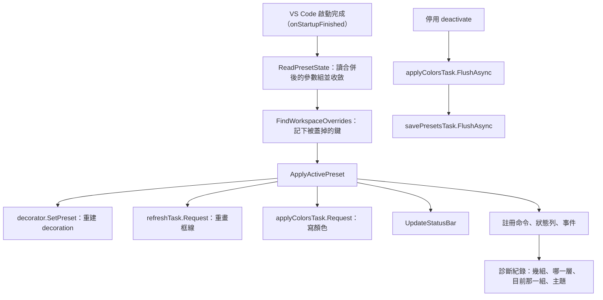
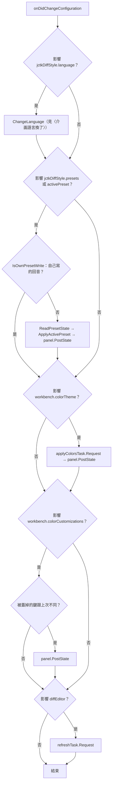
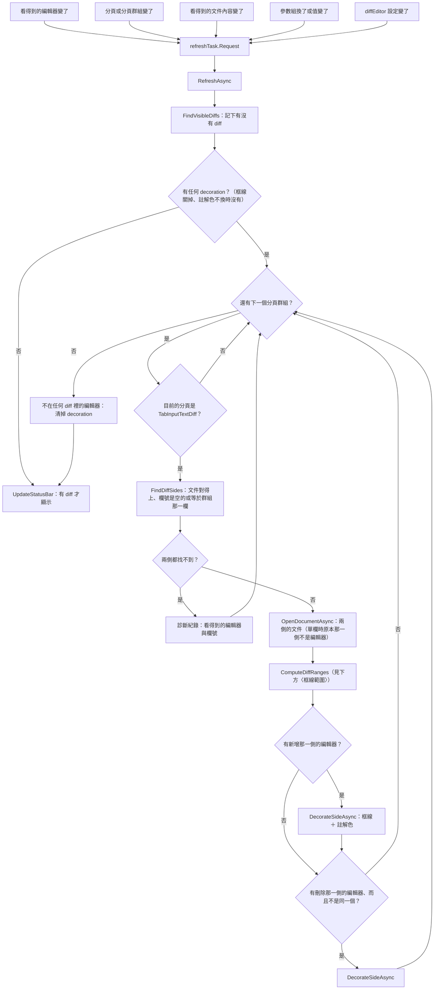
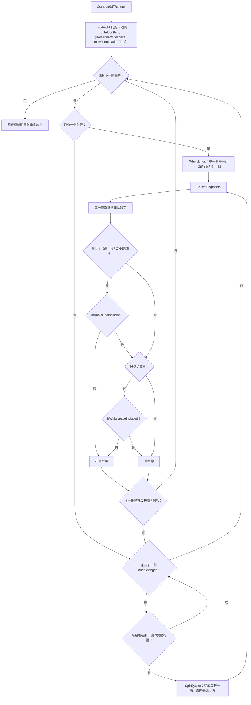
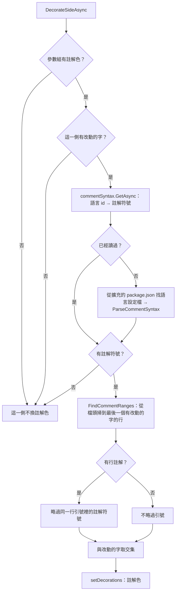
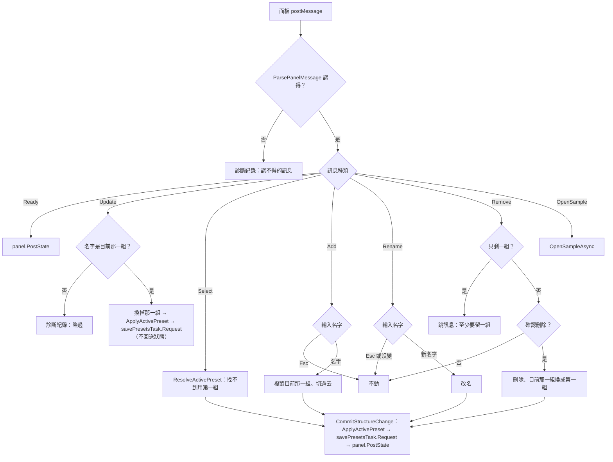
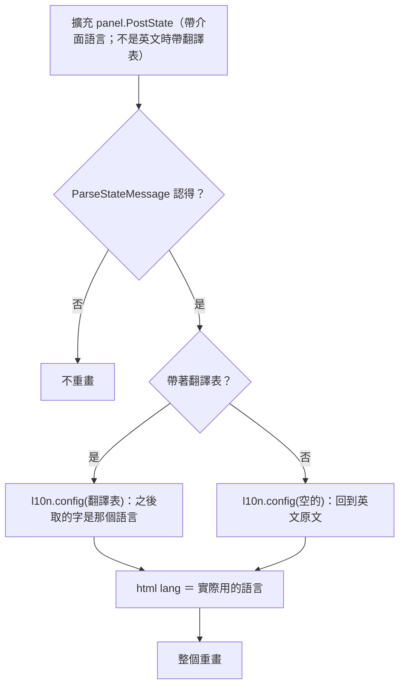
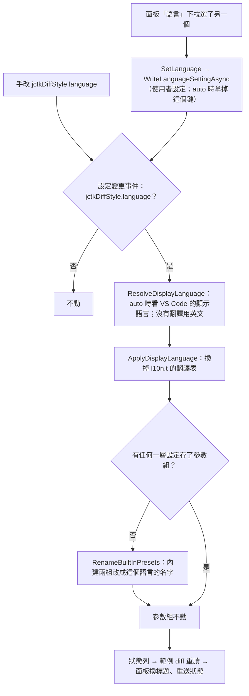
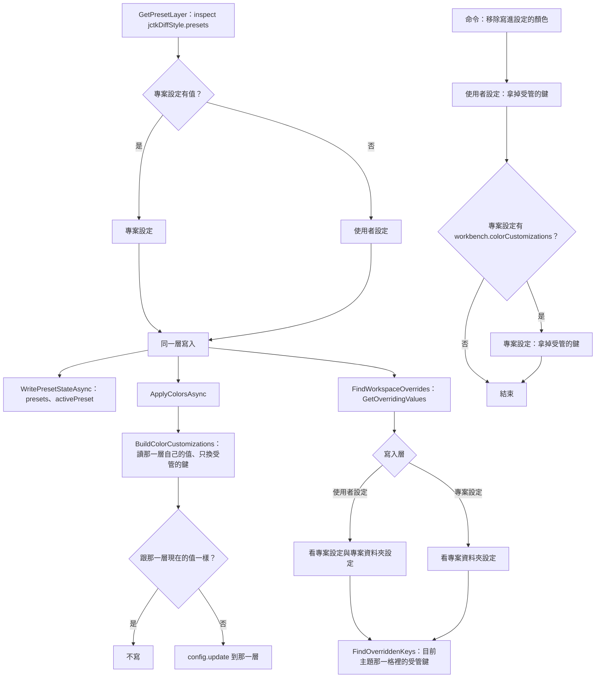
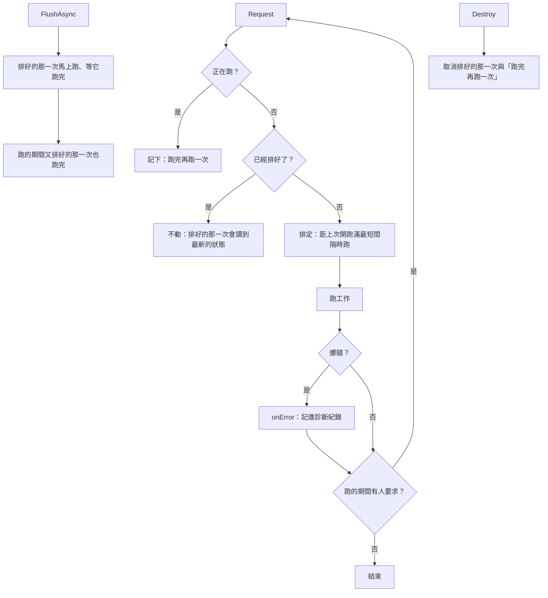

# 02. 流程圖

- 節點用程式碼裡的名字；文字只補圖講不出的
- 各流程的規則與理由在對應的那一份規格

---

## 啟用與停用

---

## 設定變更事件

每個判斷各自獨立，一次事件可能走好幾條。

---

## 畫面變化 → 重畫框線

---

## 框線範圍

---

## 註解色

---

## 面板的訊息

---

## 面板收到狀態

---

## 介面語言換了

---

## 寫到哪一層

---

## 節流

